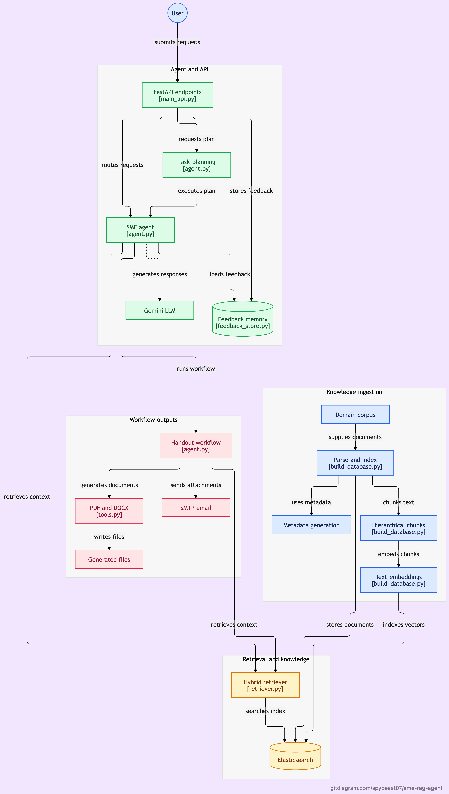

# 🧠 sme-rag-agent

A modular **SME (Subject Matter Expert) Agent System** that combines **Hybrid RAG**, **hierarchical chunking**, **Gemini LLM reasoning**, and **tool-based workflow automation** — designed originally for the **Food Safety domain**, but fully adaptable to **any expert knowledge domain**.

---

# 🚀 Features

### 🔍 Retrieval-Augmented Generation (RAG)
- Hybrid retrieval: **BM25 + dense vector search**
- **Hierarchical chunking:** 2048 → 512 → 128 token levels
- SHA-256 deduplication + metadata linking
- Elasticsearch **dense_vector(768)** + hybrid scoring

### 🤖 SME Agent System
FastAPI-based SME Agent with:
- RAG-enhanced query answering
- Workflow triggering (PDF, DOCX, email)
- Tool calling (email, document generation)
- Agent routing (**rule-based + LLM-planned**)

### 🧩 Workflows
- Create training handouts (PDF/DOCX)
- Email attachments
- Multi-step agent planning via `/plan_and_run`

### 📚 Data & Metadata
- Auto-generated metadata CSV  
- Ingestion pipeline for PDFs (FSSAI, WHO, textbooks)
- Clean text data for embeddings

### 🧠 Human Feedback Loop
- Mark answers as **good** or **bad**
- Provide corrected answers
- System dynamically adapts to corrections (online improvement)

### 🧪 Automated Testing & Verification
- Elasticsearch health check
- Chunk-level structure validation
- Mapping + embeddings check
- FastAPI agent behavior testing (chat, workflow, feedback)
- Full interactive CLI (`workflow.py`)

---

# 🧭 API Overview (FastAPI)

| Endpoint         | Description                                      |
|------------------|--------------------------------------------------|
| **POST /chat**        | RAG-powered SME question answering            |
| **POST /workflow**    | Direct workflow execution (PDF/DOCX/email)    |
| **POST /plan_and_run** | Multi-step LLM-planned workflows              |
| **POST /agent**       | Smart router (rule-based + LLM planner)        |
| **POST /feedback**    | Store good/bad answer feedback                 |
| **GET /health**       | Health check (Elasticsearch + agent readiness) |

---

# Architecture Diagram



---

# 📁 Project Structure

```bash
/sme-rag-agent/
│
├── .env                        # Environment variables (API keys, SMTP, model names)
├── .gitignore                  # Ignore feedback.json, outputs/, etc.
├── requirements.txt            # Python dependencies
├── docker-compose.yml          # Starts Elasticsearch locally
├── workflow.py                 # Interactive CLI orchestrator for full system
│
├── data/                       # Domain corpora + PDFs
│   ├── FSSAI_PDFs/             # Food safety PDFs
│   ├── text_data/              # Preprocessed text files
│   ├── Textbooks/              # Domain textbooks
│   └── WHO_Manuals/            # WHO food safety manuals
│
├── rag/                        # RAG engine
│   ├── retriever.py            # Hybrid BM25 + vector retrieval
│   └── query_rag.py            # Manual RAG quality testing
│
├── scripts/                    # Ingestion + indexing tools
│   ├── build_database.py       # Load → chunk → embed → index
│   ├── generate_metadata.py    # Create metadata CSV
│   └── tests/
│       ├── check_levels.py     # Chunk hierarchy validator
│       ├── es_check.py         # Elasticsearch health test
│       └── gemini_test.py      # Gemini LLM API validation
│
├── agent/                      # SME Agent (core logic)
│   ├── agent.py                # Agent brain: planning, workflows, QA
│   ├── feedback_store.py       # Human feedback memory
│   ├── main_api.py             # FastAPI routes
│   └── tools.py                # PDF/DOCX/email toolset
│
└── reports/                    # Runtime outputs (never commit)
    └── outputs/                # Generated PDF/DOCX/metadata
```

---

⚙️ Installation

1. Clone the repo
```bash
git clone https://github.com/<your-username>/sme-rag-agent
cd sme-rag-agent
```

2. Install dependencies
```bash
pip install -r requirements.txt
```

3. Setup .env

Create .env with:
```bash
# Elasticsearch
ES_URL=http://localhost:9200
INDEX_NAME=food_safety_rag

# Embeddings
MAIN_EMBED_MODEL=sentence-transformers/all-mpnet-base-v2
RERANKER_MODEL=BAAI/bge-reranker-base

# Gemini
GEMINI_API_KEY=your_key
GEMINI_MODEL=models/gemini-2.5-pro

# SMTP (Email support)
SMTP_HOST=smtp.gmail.com
SMTP_PORT=587
SMTP_USER=your_email
SMTP_PASS=your_password

DEFAULT_EMAIL=receiver@example.com
```

---

🧰 Build Vector Database

Run the setup workflow:
```bash
python3 workflow.py
```

Select:
```bash
→ 1. Setup system (Elasticsearch, Gemini, DB Build)
2. Run only RAG tests
3. Run Agent tests
4. Quit
```

This will:
- Parse + normalize PDFs
- Generate metadata
- Chunk documents (2048 → 512 → 128)
- Create embeddings
- Index into Elasticsearch
- Run verification tests

---

🤖 Running the SME Agent API

Start FastAPI:
```bash
uvicorn agent.main_api:app --reload
```
API docs available at:
```bash
http://127.0.0.1:8000/docs
```

---

🧪 Test the Agent

Run interactive tester:
```bash
python3 workflow.py
```

Choose:
```bash
→ 3. Run Agent tests
```

Includes:
- Basic RAG QA
- Follow-up memory test
- Workflow generation (PDF + email)
- Agent router (rule-based + LLM)
- Feedback adaptation
- ES failover test

---

🔁 Human Feedback Memory

Endpoint:
```bash
POST /feedback
```

Bad answers can be corrected and stored; future answers will automatically adapt.

---
